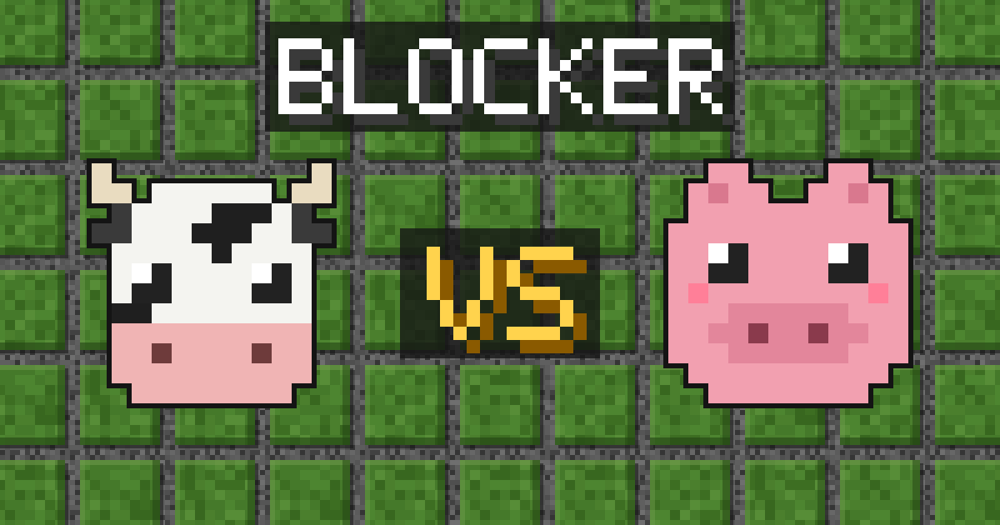

<h1 align="center">Blocker</h1>

<p align="center">
  <b>Cow vs Pig.</b> A two-player wall-building race you play by texting links back and forth.<br>
  No app, no accounts, no server. The whole game lives in the link.
</p>

<p align="center">
  <a href="https://nick-rogge.github.io/blocker/"><b>▶ Play now</b></a>
</p>

<p align="center">
  
</p>

---

## How it works

1. **Start a game.** Open the game and tap **Start New Game as Cow** or **Start New Game as Pig**.
2. **Send the link.** Text it to a friend. They're automatically the other animal, and they move first.
3. **Take turns.** Each move makes a brand-new link. Tap **Confirm & Send** and text it back.
4. Keep going until someone's animal reaches the far side.

Every link holds the full game so far, so there's nothing to sign up for and nothing stored on a server. Lost track of a game? Just open the latest link in your texts.

## Rules

Blocker is based on the classic board game *Quoridor*.

**The goal:** get your animal to any tile on the far side of the 9×9 board before your opponent gets to theirs. You always see your own animal at the bottom, heading up.

**On your turn, do one thing:**

- **Move** one tile up, down, left, or right, or
- **Place a wall** to make your opponent's path longer.

**Walls**

- Each player has **10 walls**.
- A wall is two tiles long and sits in the grooves between tiles.
- Walls can be horizontal or vertical. Once placed, they stay put.
- Walls can't overlap, can't cross each other in an X, and can't hang off the board.
- You can't completely block anyone in. There must always be a path to each goal, even if it's a long one.

**Meeting your opponent**

- Two animals can never share a tile.
- If your opponent is right next to you, moving toward them **jumps over** them to the tile behind.
- If a wall or the edge of the board is behind them, you can **step diagonally** to either side of them instead.

## Controls

| Control | What it does |
| --- | --- |
| **Move** | The tiles you can reach glow. Tap one to preview the move. |
| **Wall** | Tap a groove between tiles to preview a wall there. The number shows how many you have left. |
| **↻** | Rotates the wall you're placing. |
| **Confirm & Send** | Locks in your move and opens your phone's share sheet so you can text the new link. |

Nothing counts until you tap Confirm, so a mis-tap never costs you a move. If a wall spot isn't allowed, it turns red and tells you why. Your opponent's last move is outlined in gold when you open their link.

## Run it yourself

You'll need [Node.js](https://nodejs.org/) 20.19 or newer.

```bash
git clone https://github.com/nick-rogge/blocker.git
cd blocker
npm install
npm run dev     # play locally at the address it prints
npm test        # run the rules, link, and board tests
npm run build   # build the static site into dist/
```

Every push to `main` is tested and published to GitHub Pages automatically (see `.github/workflows/deploy.yml`).

## How it's built

- **Vite + TypeScript**, with no UI framework. The board is a single SVG.
- **`src/game/`** is the rules engine: moves, jumps, walls, the path check, and winning. It's plain functions with no screen code, so it's easy to test.
- **`src/codec/`** turns a game into the short link text (like `#v1.c.DUhAvFLR`) and back. Every link is replayed move by move through the rules, so an edited link is caught instead of showing an impossible board.
- **`src/ui/`** handles drawing the board, flipping it for the Pig player, tapping, and sharing.
- All the pixel art (board, cow, pig, and walls) is original and lives in `public/`.

## License

[MIT](LICENSE). Use it, change it, share it.
